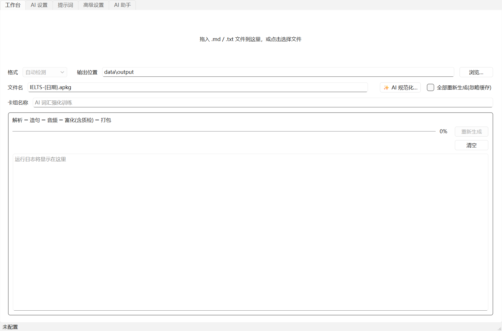
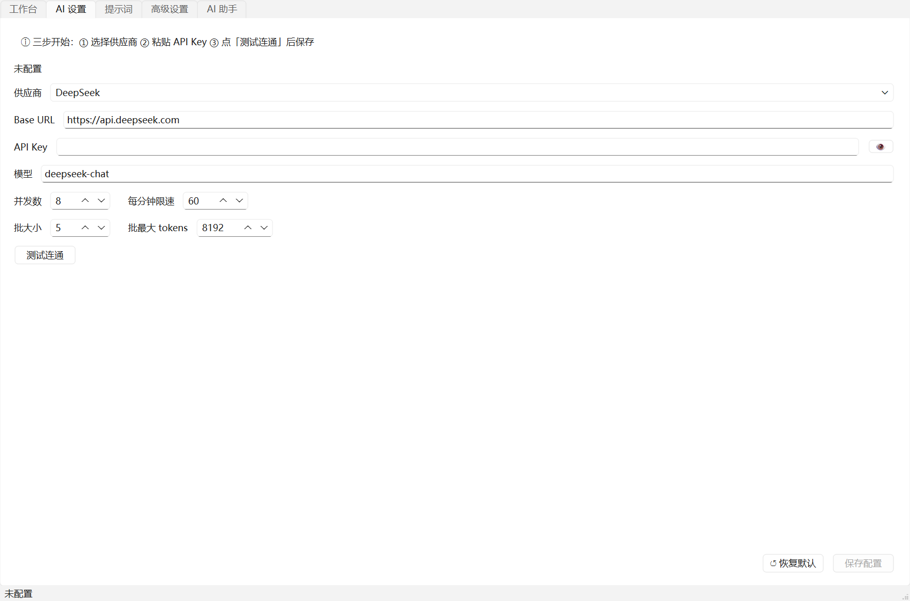
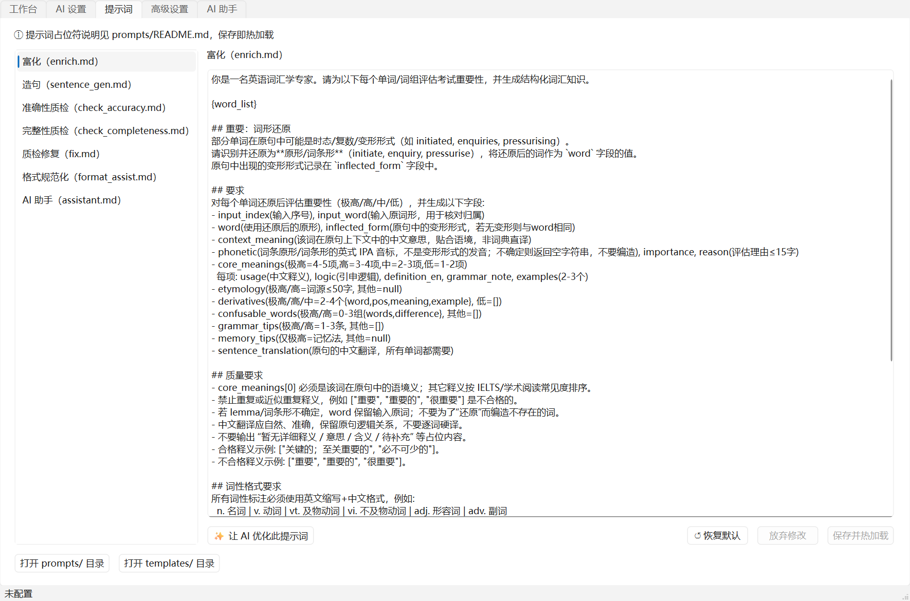
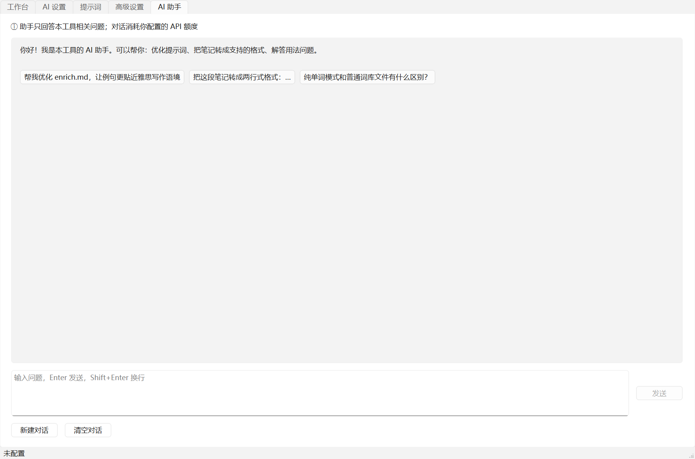

<div align="center">

# 🎴 AnkiMint

**AI-powered Anki vocabulary cloze deck generator**
Turn your word lists into Anki decks with typing practice, context hints, native audio, and etymology

[](https://github.com/yummytrush/anki-mint-vocabulary/actions/workflows/ci.yml)
[](https://github.com/yummytrush/anki-mint-vocabulary/releases)
[](LICENSE)


English | [简体中文](README.md)

</div>

---



## ✨ Features

- **Forgiving input** — auto-detects three Markdown list formats (single-line / two-line Obsidian / colon style), plus a **pure word-list mode** where the AI writes IELTS-style example sentences first; dirty files get pre-checked with problem lines located
- **Deep AI enrichment** — in-context Chinese meaning, etymology, core-meaning table (English definitions + grammar notes), derivatives, confusables, grammar & memory tips — works with any OpenAI-compatible API (DeepSeek, OpenAI, Azure, vLLM, Ollama…)
- **Cloze + typing cards** — sentence cloze with a Chinese context hint on the front and the full word card on the back; deck name and card templates customizable
- **Dual TTS engines** — gTTS first, Edge TTS fallback, no stalling when offline; voice selectable
- **Dual AI reviewers** — accuracy + completeness roles check every word, auto-repair on failure, and survivors are listed in the run summary
- **Incremental cache** — resume interrupted runs; unchanged sentences never re-billed; only new/altered words are processed
- **GUI + CLI** — PySide6 desktop app (drag & drop, progress, logs, built-in AI assistant) alongside a full-featured CLI
- **Prompts & templates externalized** — plain text files under `prompts/` and `templates/`; edit to change behavior, delete to fall back to built-in defaults

## 🚀 Quick Start

### Option 1: Download the exe (recommended, no Python needed)

1. Grab `AnkiMint.exe` from [Releases](https://github.com/yummytrush/anki-mint-vocabulary/releases)
2. Open it → AI Settings tab → pick a provider, paste your API Key → Test connection → Save
3. Back to the Workbench, drop in your word list → Start → import the generated `.apkg` into Anki

> 💡 No API key yet? [DeepSeek](https://platform.deepseek.com/) is a good default — cheap enough that a 100-word run costs well under a dollar.



### Option 2: pip (from source)

```bash
git clone https://github.com/yummytrush/anki-mint-vocabulary.git
cd anki-mint-vocabulary
pip install -e .

anki-mint-gui        # GUI
# or
anki-mint --help     # CLI
```

### Option 3: CLI

```bash
cp .env.example .env     # fill in LLM_API_KEY (or save config from the GUI)

python vocab_anki_generator.py \
  --input data/input/words.md \
  --output data/output/output.apkg

# trial run with 2 words
python vocab_anki_generator.py --input data/input/words.md --limit 2
```

## 📥 Input Formats

Any of the following works (see [examples/](examples/)):

| Format | Style | Example file |
|---|---|---|
| A · Single-line | `1. word sentence` | [example-single-line.md](examples/example-single-line.md) |
| B · Two-line (Obsidian-friendly) | `1. **word**` + `> sentence` | [example-two-line.md](examples/example-two-line.md) |
| C · Colon style | `1. **word**: sentence` | [example-colon.md](examples/example-colon.md) |
| D · Pure word list | one word per line, optional Chinese hint; AI writes sentences | [example-word-list.md](examples/example-word-list.md) |
| Dirty file | unrecognizable lines → located by pre-check, never fatal | [example-dirty.md](examples/example-dirty.md) |

<details>
<summary>📄 More screenshots</summary>

| Prompt editor (hot-reloads on save) | AI assistant (prompt tuning, format conversion) |
|---|---|
|  |  |

</details>

## 🤖 AI Format Assistant

Messy notes? Two ways to normalize:

- **GUI**: "✨ AI normalize" on the Workbench, or ask the assistant tab to convert your notes into a supported format (it outputs a full, replace-ready file)
- **CLI**: `python vocab_anki_generator.py --format-input messy.md --target-format two_line` — output lands in `data/intermediate/`, edit by hand before generating

## 🛠 Pipeline

```
Markdown list ──► parse + pre-check ──► (word list: AI sentences) ──► TTS audio ──► AI enrichment ──► dual AI review + repair ──► .apkg
```

All artifacts live under `data/`: `output/` (.apkg), `cache/` (enrichment cache), `media/` (mp3), `logs/`, `config.json` (GUI config, **contains your key, gitignored**).

## ⚙️ Configuration

Priority: **CLI args > `data/config.json` (GUI) > env vars / `.env` > defaults**.
Common options (full list in [.env.example](.env.example) and the GUI Advanced tab tooltips):

| Option | Default | Description |
|---|---|---|
| `LLM_API_KEY` | — | API key, stored locally only |
| `LLM_BASE_URL` | `https://api.deepseek.com` | any OpenAI-compatible endpoint |
| `MAX_CONCURRENCY` | 8 | max parallel requests (biggest speed lever) |
| `BATCH_SIZE` / `BATCH_MAX_TOKENS` | 5 / 8192 | words per batch / per-batch output cap |
| `TTS_PROVIDER` | `auto` | `auto`/`gtts`/`edge`/`none` |
| `AUDIO_PROXY` | — | proxy for gTTS, e.g. `http://127.0.0.1:7890` |
| `QUALITY_CHECKS_ENABLED` | true | dual AI review |

## ❓ FAQ

<details>
<summary><b>Audio fails / the run is slow?</b></summary>

gTTS depends on `translate.google.com`, which is unreachable in some networks. The tool pre-checks connectivity within ~2s → falls back to Edge TTS (needs `pip install edge-tts`) → skips audio with a clear warning if both fail — it never stalls. With a proxy, set `AUDIO_PROXY`. Check `data/logs/generator.log`; re-run with `--refresh-audio` once the network is fixed.

</details>

<details>
<summary><b>How do I import into Anki?</b></summary>

Double-click the `.apkg`, or use File → Import in Anki. Deck names support `{book}/{date}` placeholders. Cards are cloze + type-in; any modern Anki (desktop/mobile/web) works.

</details>

<details>
<summary><b>Is my API key safe?</b></summary>

The key stays on your machine (`.env` or `data/config.json`, both gitignored). Requests go directly from your device to the API provider — this project has no middleman server. Shared exe builds never contain your key. Sanitize logs before filing issues.

</details>

<details>
<summary><b>What does it cost?</b></summary>

Per word: one batched enrichment call (5 words/batch by default) + 2 reviewer calls, plus 1–2 repairs when needed. A 100-word full run ≈ 250+ calls, 1–3M tokens — typically a couple of USD with DeepSeek pricing. Cached re-runs are nearly free.

</details>

<details>
<summary><b>Custom prompts / card styling?</b></summary>

Edit `prompts/*.md` (hot-reloads on save; editable in the GUI Prompts tab) or the `templates/` trio (front/back HTML + CSS). Delete a file to restore the built-in default. See [prompts/README.md](prompts/README.md) and [templates/README.md](templates/README.md). The exe build uses built-in defaults; customize via source instead.

</details>

<details>
<summary><b>Antivirus flags the exe?</b></summary>

Unsigned PyInstaller onefile builds are commonly flagged. Verify the SHA-256 attached to the Release, build from source (`python scripts/build_exe.py`), or use the pip route. If this concerns you, don't download the exe.

</details>

<details>
<summary><b>Run interrupted / switching machines?</b></summary>

Re-run the same command: enriched words that passed review are reused from cache. Copy `data/` to a new machine to take cache and audio with you.

</details>

## 🧑‍💻 Development

```bash
pip install -e .[dev]                  # includes pytest / pytest-qt
python -m pytest tests/ -v             # fully offline tests
QT_QPA_PLATFORM=offscreen python -m app.gui   # headless GUI
python scripts/build_exe.py            # build single-file exe (--console for logs)
```

- Architecture & known behavior: [CLAUDE.md](CLAUDE.md); design docs: [docs/](docs/); known issues: [docs/known-issues.md](docs/known-issues.md)
- Contributions welcome — see [CONTRIBUTING.md](CONTRIBUTING.md)

## 📄 License

[MIT](LICENSE) © 2026 Lee Chen (AnkiMint)
